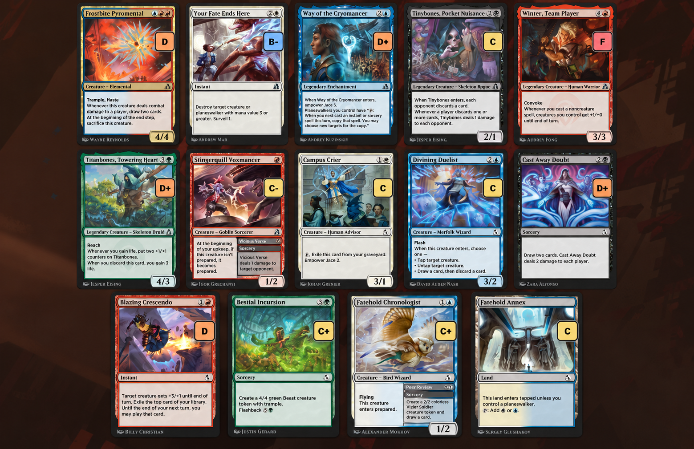
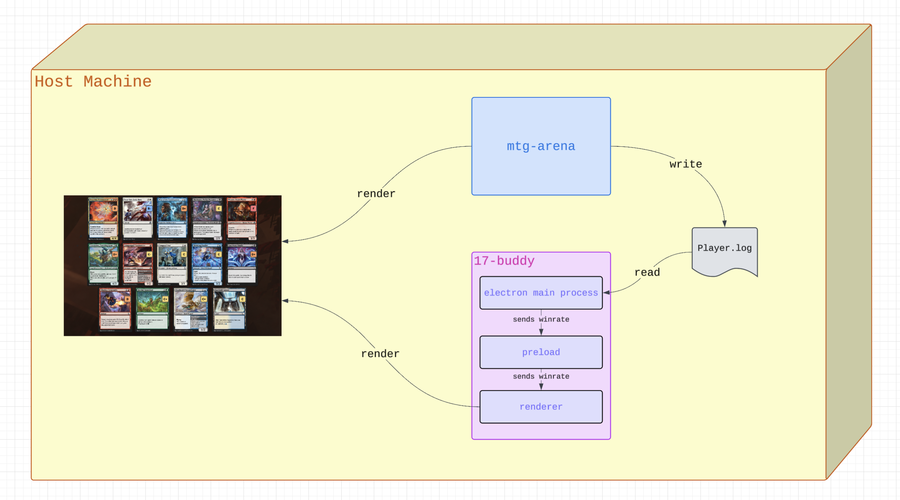
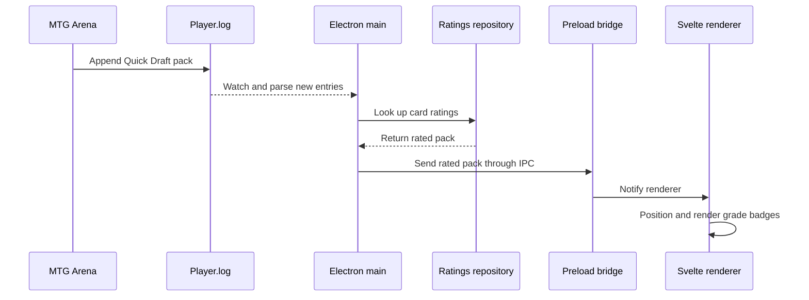

# 🃏 17-buddy

> An experimental, non-commercial MTG Arena Quick Draft overlay that displays
> 17Lands card win-rate grades directly on the draft screen.



## Overview

17-buddy watches the local MTG Arena log, detects each Quick Draft pack, joins
the card IDs with embedded 17Lands ratings, and renders a transparent Electron
overlay over Arena. The overlay follows the Arena window, scales with it, and
hides its badges while a card is enlarged on hover.

The project is in active development and runs on macOS and Windows. This
repository currently provides the source code as a developer and portfolio
project; signed installers are planned for a future release.

17-buddy is a passive, local companion. It reads only newly appended draft
events from Arena's local `Player.log` and observes the foreground Arena window
to position the overlay. It does not modify or inject code into the Arena
client, automate input, connect to Wizards services, or transmit logs,
gameplay data, or telemetry.

## Features

- Detects Quick Draft packs from newly appended Arena log entries.
- Displays a color-coded grade on each card.
- Matches Arena's visual card ordering by rarity and color.
- Tracks fullscreen, resized, moved, and secondary-display Arena windows.
- Hides the overlay when Arena loses focus.
- Keeps the enlarged Arena card preview readable by hiding badges on hover.
- Loads ratings locally from embedded JSON; no network connection is required
  at runtime.

## Setup

### Prerequisites

- Node.js 22.13 or newer
- npm
- MTG Arena with **Detailed Logs** enabled

To enable detailed logs, open Arena and select **Options → View Account →
Detailed Logs**, then restart Arena. See the
[official Arena logging instructions](https://mtgarena-support.wizards.com/hc/en-us/articles/360000726823-Creating-Log-Files-on-PC-Mac-Steam).

### Run from source

```bash
git clone https://github.com/ratek-20/17-buddy.git
cd 17-buddy
npm install
npm start
```

17-buddy starts in the background and prints its status in the terminal. Start
it before opening the draft so it can process new log entries. No separate app
window opens; grade badges appear when Arena is showing a supported Quick Draft
pack.

## Architecture

Electron owns operating-system integration, Arena log processing, card-rating
lookup, and the transparent overlay window. A constrained preload bridge sends
rated packs to the Svelte renderer, which only handles presentation and card
geometry.

### Component overview



### Pack processing



See [Architecture](docs/architecture.md) for the detailed component, overlay
tracking, and card-data generation diagrams.

## Card data

Runtime datasets live in `card-data/<SET>.json`. Raw inputs are intentionally
excluded from Git. Embedded ratings currently cover DFT, ECL, and FRA.

- `scripts/build_card_win_rates.py` processes official 17Lands public game-data
  CSV files.
- `scripts/build_card_win_rates_from_ui.py` processes a CSV manually exported
  from the 17Lands Card Data table when a public game dataset is not yet
  available.
- Both builders use the
  [official 17Lands public card list](https://17lands-public.s3.amazonaws.com/analysis_data/cards/cards.csv)
  to map cards to Arena IDs.

The DFT and ECL ratings and shared card-list metadata are adapted from
[17Lands Public Data](https://www.17lands.com/public_datasets), licensed under
[CC BY 4.0](https://creativecommons.org/licenses/by/4.0/). For ECL, 17-buddy
aggregates game records into GIH win rates, calculates grades, selects runtime
fields, and maps cards to Arena IDs.

The FRA ratings are derived from a CSV manually exported in October 2026 from
the publicly accessible
[17Lands FRA Card Data table](https://www.17lands.com/card_data?expansion=FRA&format=PremierDraft&time_period=ALL_TIME).
17-buddy filters ratings by sample size, rounds the displayed statistics,
calculates letter grades, selects the fields required at runtime, and maps cards
to Arena IDs. FRA is not represented here as part of the CC BY 4.0 public
dataset collection. The raw exported CSV is not included in this repository.

17Lands does not endorse this project.

Grades use the 17Lands model: a normal distribution centered on `C`, with each
gradation representing 0.33 standard deviations.

## Development

```bash
npm test
npm run typecheck
npm run lint
python3 -m unittest discover -s tests -p 'test_*.py'
```

## License

The original application source code is available under the
[MIT License](LICENSE). The license does not grant rights to MTG Arena imagery,
Magic card content, trademarks, 17Lands data, or other third-party materials.
Those materials remain subject to their respective owners' terms and policies.

## Acknowledgments

- [17Lands](https://www.17lands.com/) for draft statistics and public datasets.
- [Wizards of the Coast](https://company.wizards.com/) for Magic: The Gathering
  and MTG Arena.

17-buddy is an independent project and is not affiliated with or endorsed by
17Lands.

17-buddy is unofficial Fan Content permitted under Wizards'
[Fan Content Policy](https://company.wizards.com/en/legal/fancontentpolicy) and
is not approved or endorsed by Wizards. Portions of the materials used are
property of Wizards of the Coast LLC. © Wizards of the Coast LLC. Use of MTG
Arena remains subject to Wizards' applicable terms and policies.
