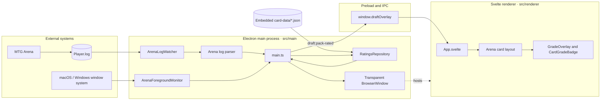
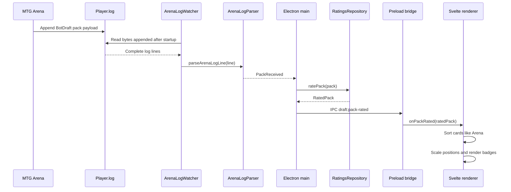
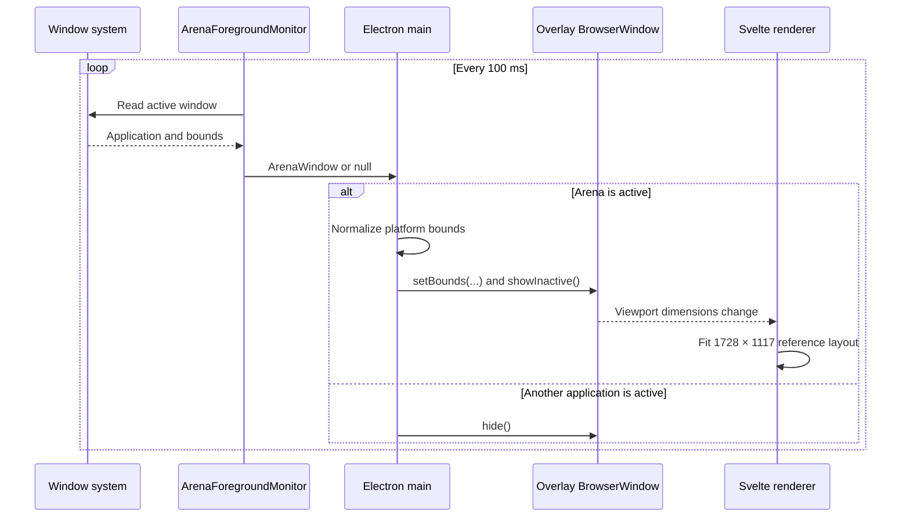
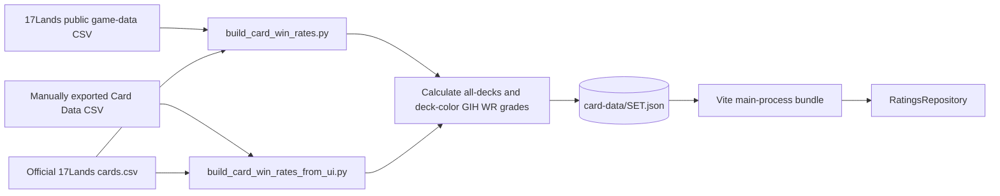

# Architecture

17-buddy separates desktop integration from presentation. Electron's main
process observes Arena and prepares rated draft data; the Svelte renderer
receives that data through a narrow preload API and draws the badges.

## Component overview

The main process is the coordinator. It keeps Arena-specific log and window
behavior out of Svelte. The preload script exposes only `onPackRated`, so the
renderer has no direct Node.js or Electron access.

## Pack processing sequence

The watcher starts at the end of the existing file, so historical draft events
are ignored. It reads only content produced while 17-buddy is running and
resets safely if Arena replaces or truncates the log.

## Overlay tracking sequence

Windows physical coordinates are converted to Electron device-independent
pixels. macOS fullscreen bounds are normalized when the system reports only a
top inset. Svelte does not know where Arena is; it reacts only to the size of
its own overlay viewport.

## Card-data generation

Raw CSV files remain local under the ignored `raw-card-data/` directory. The
tracked JSON contains only the runtime card fields required by the overlay.
